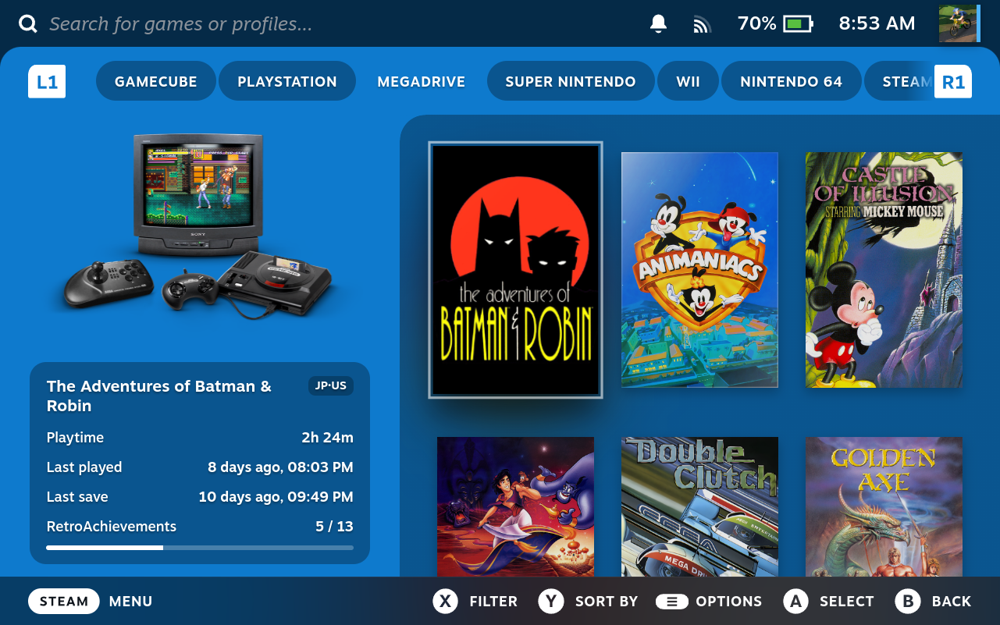
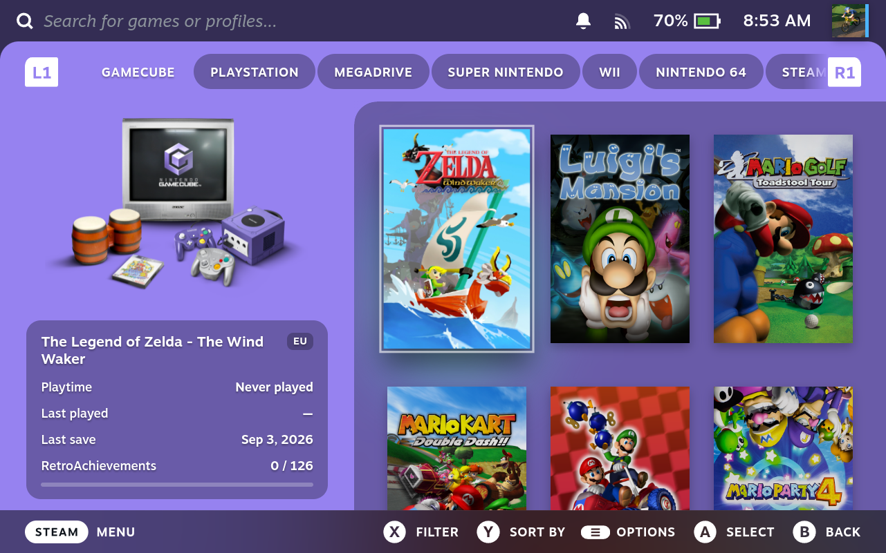
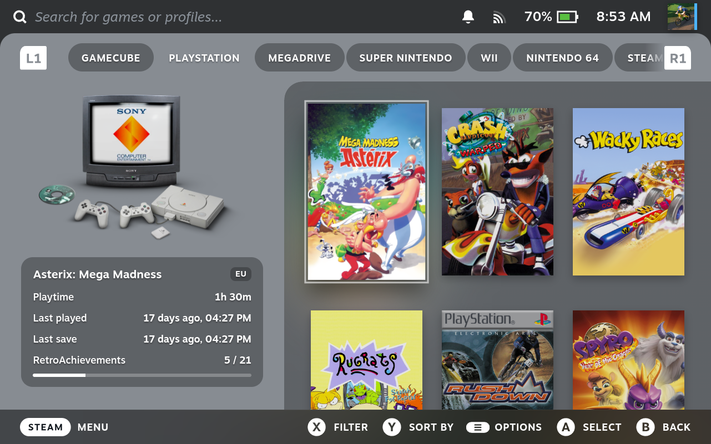
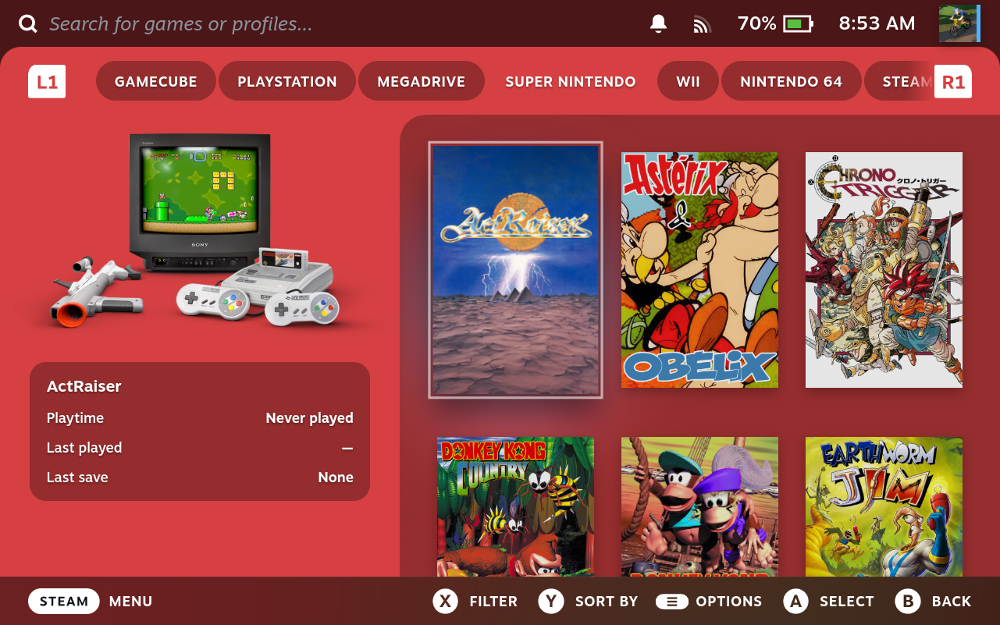
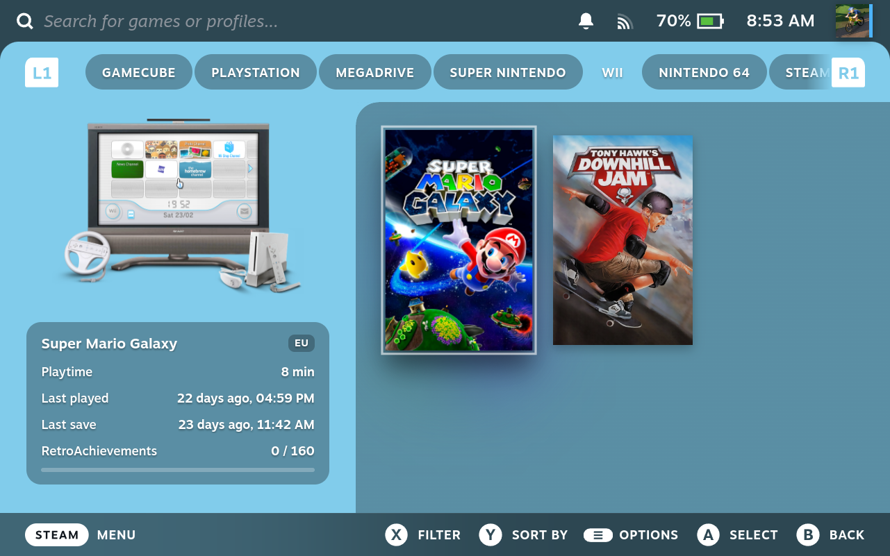
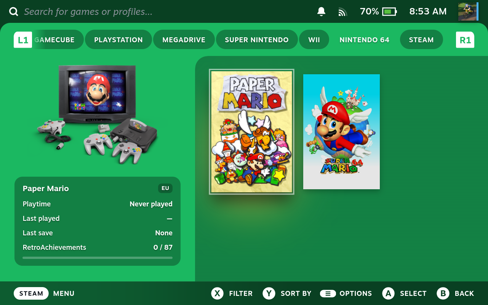
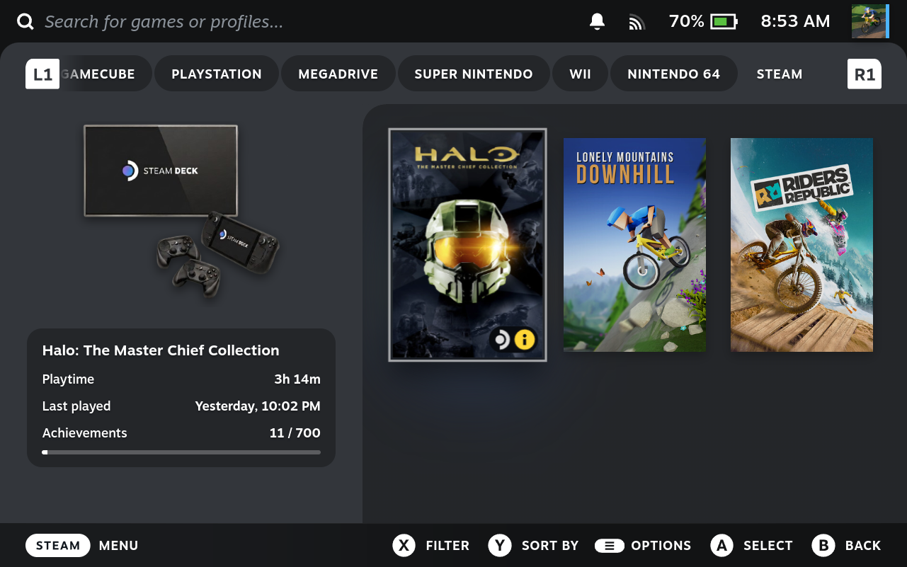

# Colorful

A Decky plugin for the Steam Deck library: each TabMaster console tab gets a
colored panel on the left third with the console's artwork, and an info box
about the selected game — playtime, last session, last save, RetroAchievements
progress on emulated games, Steam achievements on native ones.



| | | |
| --- | --- | --- |
|  |  |  |
|  |  |  |

The look and the console artwork are credited at the bottom of this file. If
you want to work on the plugin itself, see [docs/DEVELOPMENT.md](docs/DEVELOPMENT.md)
for the repo layout and how the pieces fit together.

## Usage

### 1. Prerequisites

Colorful only *decorates* tabs that already exist in your library. Three
things need to be set up first, in this order:

- **[EmuDeck](https://www.emudeck.com/)** — emulators, ROMs, and one Steam
  collection per console.
- **[Decky Loader](https://decky.xyz/)** — the plugin framework Colorful
  (and every other Decky plugin) runs on.
- **[TabMaster](https://github.com/JanMalch/decky-tab-master)** — turns
  those collections into tabs in the library.

See [docs/setup-details.md](docs/setup-details.md) for the full walkthrough.

### 2. Install

- **From a GitHub release** (recommended for now): in the Decky menu, open
  the settings (gear icon), turn on **Developer mode** under General, then
  under **Developer** choose **Install Plugin from URL** and enter:

  ```
  https://github.com/cedricdelpoux/steam-deck-colorful/releases/latest/download/Colorful.zip
  ```

- **From the Decky Store**: not listed yet.
- **From source**: see [docs/DEVELOPMENT.md](docs/DEVELOPMENT.md#building-and-installing-from-source).

### 3. Configure

#### Console

Colorful tries to match every TabMaster tab to a console automatically,
from the tab's title (compound names like `Sega Genesis/Mega Drive` are
split, and a couple of aliases cover the Steam tab itself) — see
[docs/consoles.md](docs/consoles.md) for the full name/artwork/color table.

To fix a tab that didn't auto-match, or override one you don't like, open
the Decky menu → **Colorful** → **Tabs** and pick its console artwork by
hand, or "No panel" to leave it plain, unstyled Steam.

The color always follows the *tab's own title*, not the artwork file: the
source theme's own palette can give what's otherwise the same hardware two
different colors depending on the regional name a tab uses.

#### RetroAchievements

For RetroAchievements progress on emulated games, set your username and
web API key in the Decky menu → **Colorful** (Settings › Web API key on
retroachievements.org). **The key stays in
`~/homebrew/settings/Colorful/settings.json` on the Deck** — it is
deliberately not in this repo and must not be synced to Dropbox.

## Credits

The panel's look and the console renders are based on **COLORFUL**, a theme by
**Viking** for the Pegasus/LaunchBox frontends:
https://forums.launchbox-app.com/topic/55213-colorful-resources/
Used with the author's permission.
